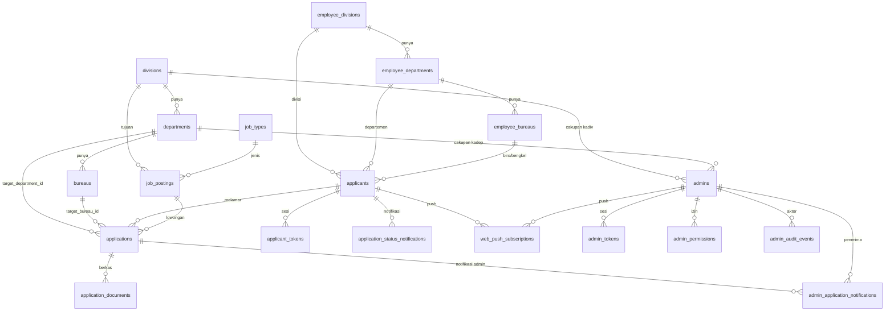

# Struktur database

PostgreSQL, skema dikelola oleh migrasi SQLx di `services/app-backend/migrations/` (dijalankan otomatis saat backend start).

## Dua hierarki unit yang berbeda (sengaja dipisah)

| | Hierarki **organisasi** (target) | **Master data karyawan** (asal) |
|---|---|---|
| Tabel | `divisions` > `departments` > `bureaus` | `employee_divisions` > `employee_departments` > `employee_bureaus` |
| Menu admin | Unit Kerja | Manajemen Akun > Master Data |
| Dipakai oleh | lowongan, tujuan lamaran langsung (`applications.target_*`), cakupan akun admin | profil pelamar (`applicants.division_id/department_id/bureau_id`) |
| Pengisian | admin (Unit Kerja) | import Excel (divisi, departemen), admin/pelamar (biro) |

Lamaran menyimpan **salinan teks** data asal pelamar (`applications.origin_division`, `origin_unit`) supaya riwayat lamaran tidak berubah ketika master data diubah.

## Diagram relasi

## Aturan integritas penting

- **Hierarki konsisten lewat FK komposit.** `applicants (department_id, division_id)` mereferensikan `employee_departments (id, division_id)` dan `applicants (bureau_id, department_id)` mereferensikan `employee_bureaus (id, department_id)`. Jadi departemen tidak mungkin berpasangan dengan divisi yang salah, dan biro tidak mungkin berada di departemen lain. Constraint `applicants_bureau_requires_department_check` melarang biro tanpa departemen.
- **Tidak ada penghapusan diam-diam.** Semua relasi master memakai `ON DELETE RESTRICT`: divisi/departemen/biro yang masih punya turunan atau dipakai akun pelamar tidak bisa dihapus.
- **Nama unik per induk** (tanpa membedakan huruf besar/kecil): `employee_divisions (lower(name))`, `employee_departments (division_id, lower(name))`, `employee_bureaus (department_id, lower(name))`.
- **NIP (`employee_number`) unik lintas akun.** Unik di `applicants` dan di `admins`, serta trigger `enforce_unique_employee_number` mencegah NIP yang sama dipakai pelamar dan admin sekaligus (login memakai NIP).
- **Email opsional** untuk pelamar (`applicants.email` boleh NULL, unik bila ada) dan wajib untuk admin. Email disimpan huruf kecil (CHECK). Email bukan pengenal login.
- **Sesi** disimpan di `applicant_tokens` / `admin_tokens` (hash token, kedaluwarsa), terhapus otomatis bersama akunnya (`ON DELETE CASCADE`).

## Tabel yang dihapus pada migrasi 0036 dan 0039

- `password_reset_tokens` (fitur lupa kata sandi dihapus; admin mereset ke kata sandi default).
- `employees`, `api_tokens` (sisa skema awal, tidak dipakai kode) dan `employee_directory` beserta izin `employees.view/manage` (digantikan akun pelamar + master data karyawan).

## Kolom lama yang masih ada

`applications.phone_number`, `current_position`, `current_unit` adalah kolom lama (kosong pada lamaran baru). Dipertahankan karena data riwayat lamaran lama mungkin masih memakainya.

## Konkurensi

Aturan idempotensi, kunci baris, dan advisory lock untuk tiap alur dijelaskan di [concurrency.md](concurrency.md). Tabel `idempotency_keys` menyimpan respons yang bisa diulang untuk permintaan pembuatan (kunci dihapus otomatis setelah 48 jam).
